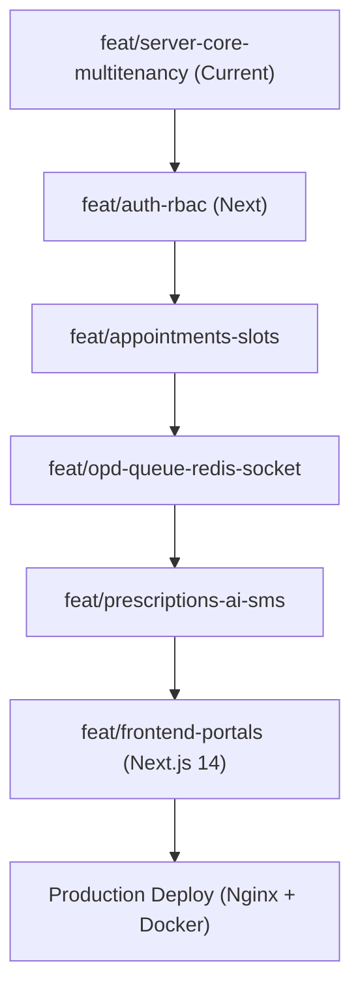

# Med_Pilot — Agent Context & Project State Tracker (`agent.md`)

**Last Updated:** October 29, 2026  
**Active Working Branch:** `feat/server-core-multitenancy`  
**Repository:** `med_flow` (Med_Pilot)

---

## 1. Project Overview & Core Mission

**Med_Pilot** is a production-grade, multi-tenant healthcare operations platform designed to solve operational bottlenecks in clinics and multi-specialty hospitals:
1. **OPD Queue Congestion:** Eliminating physical wait lines using an in-memory Redis sorted set token engine and Socket.io real-time updates.
2. **Scattered Patient Histories:** Unified patient medical timeline (visits, diagnoses, lab records, prescriptions).
3. **Doctor Cognitive Load:** Pre-consultation 3-sentence clinical summary synthesized via Claude 3.5 Sonnet (cached in Redis with 1h TTL).
4. **Post-Discharge Disengagement:** Automated SMS reminders and follow-up alerts via BullMQ background jobs.

---

## 2. Git & Branching State

- **Branches:**
  - `main`: Production release branch (Base commit: `7ddb26b` - *initial readme commit*).
  - `develop`: Integration branch.
  - `feat/server-core-multitenancy`: **Current active branch** (focused on core server infrastructure and multi-tenant resolution).
- **Git Working Tree Status:**
  - `server/` initialized with `package.json`, `package-lock.json`, and dependencies installed (`node_modules/` ignored via root `.gitignore`).
  - No commits yet on `feat/server-core-multitenancy`.

---

## 3. Work Done So Far (Completed)

| Component | Status | Details |
| :--- | :--- | :--- |
| **Architectural Design (`README.md`)** | ✅ Done | Documented four-tier architecture (Next.js 14, Nginx, Express API, Redis + Mongo, BullMQ, Claude AI), row-level multi-tenancy, and Git-flow roadmap. |
| **Git & Repository Setup** | ✅ Done | Git initialized, branches created (`main`, `develop`, `feat/server-core-multitenancy`), root `.gitignore` configured. |
| **Server Core Scaffolding** | ✅ Done | Express 5 application setup with Helmet, CORS, Morgan, health checks, and global error handling (`src/app.ts`, `src/server.ts`). |
| **Config & Type Safety** | ✅ Done | Environment validation with Zod (`src/config/env.ts`), TypeScript compilation verified (`npm run build` passing with zero errors), `tsx watch` configured for hot reloading. |
| **Database & Cache Clients** | ✅ Done | MongoDB Mongoose client (`src/config/db.ts`) with reconnect/failover hooks, Redis `ioredis` client (`src/config/redis.ts`) with ping monitoring. |
| **Multi-Tenancy Engine** | ✅ Done | Hospital Tenant Mongoose Model (`src/models/tenant.model.ts`), Request type merging (`src/types/express.d.ts`), and Subdomain/Header extraction middleware with Redis cache fallback (`src/middlewares/tenant.middleware.ts`). |
| **Git Hooks & Code Quality (Husky)** | ✅ Done | Installed Husky, Lint-Staged, ESLint (Flat Config), Prettier, and automated pre-commit hook running `tsc --noEmit` and `eslint --fix` before any commit can pass. |
| **Multi-Tenant Auth & RBAC (Milestone 2)** | ✅ Done | User model with per-tenant compound index (`tenantId: 1, email: 1`), 5 roles enum (`SUPERADMIN`, `HOSPITAL_ADMIN`, `DOCTOR`, `RECEPTIONIST`, `PATIENT`), bcrypt password hashing, JWT Access (15m) + Redis Refresh Token (7d) rotation, Cross-tenant security guard, and role-based `authorize()` middleware (`src/routes/auth.routes.ts`). |

---

## 4. Where We Were (Current Exact Position)

We are at the **genesis of Milestone 1 (`feat/server-core-multitenancy`)**:
- Dependencies in `server/` are installed.
- **Not yet created:**
  - `server/tsconfig.json`
  - `server/.env.example` & `.env`
  - `server/src/` directory layout
  - Database & Cache clients (`Mongoose` connection with graceful shutdown, `ioredis` connection)
  - Environment variable schema validation (`zod`)
  - Express app entrypoint & middlewares (Helmet, CORS, Morgan, Error handler)
  - `Tenant` Mongoose schema & model
  - Multi-tenant extraction middleware (`tenant.middleware.ts`) with Redis caching

---

## 5. What We Have To Do Now (Immediate Next Steps)

### Phase 1: Core Server & Multi-Tenancy Engine (`feat/server-core-multitenancy`)

1. **TypeScript & Scripts Setup (`server/tsconfig.json` & `package.json`):**
   - Configure strict TypeScript settings with path aliases (e.g. `@/*` mapping to `src/*`).
   - Add scripts: `"dev": "ts-node-dev --respawn --transpile-only src/server.ts"`, `"build": "tsc"`, `"start": "node dist/server.js"`.

2. **Environment Configuration with Zod (`server/src/config/env.ts`):**
   - Create schema validation for `PORT`, `NODE_ENV`, `MONGO_URI`, `REDIS_HOST`, `REDIS_PORT`, `REDIS_PASSWORD`, `JWT_SECRET`, etc.
   - Provide `.env.example` template.

3. **Database & Cache Connections (`server/src/config/`):**
   - `db.ts`: MongoDB connection manager with auto-reconnect, connection events, and graceful termination hooks.
   - `redis.ts`: Redis client wrapper using `ioredis` with health ping check.

4. **Multi-Tenant Model (`server/src/models/tenant.model.ts`):**
   - Schema fields:
     - `name`: string (e.g. "Apollo Hospital Bangalore")
     - `slug` / `subdomain`: string (unique, indexed, e.g. "apollo")
     - `status`: `'active' | 'suspended' | 'trial'`
     - `contact`: email, phone, address
     - `settings`: branding (colors, logo), consultation fee defaults, OPD hours
     - `createdAt`, `updatedAt`

5. **Tenant Resolution Middleware (`server/src/middlewares/tenant.middleware.ts`):**
   - Extract subdomain from hostname or `X-Tenant-ID` header (fallback for development/API testing).
   - Check cache in Redis (`tenant:slug:<slug>`) with 1-hour TTL.
   - If cache miss, query MongoDB, populate cache, or return `404 Tenant Not Found`.
   - Ensure tenant is `active`; reject if `suspended` (`403 Forbidden`).
   - Attach `req.tenant` to Express `Request` object (via TS declaration merging).

6. **Application Bootstrapping (`server/src/app.ts` & `src/server.ts`):**
   - Register global middlewares (`helmet`, `cors`, `express.json()`, `morgan`).
   - Health check endpoint: `GET /health` verifying MongoDB state, Redis ping, and server uptime.
   - Global 404 handler and central error-handling middleware.

7. **Verification & Git Commit:**
   - Test server boot (`npm run dev`) and health check ping.
   - Commit code to `feat/server-core-multitenancy` and prepare PR/merge into `develop`.

---

## 6. Long-Term Project Roadmap

- **Feature 2 — `feat/auth-rbac`:**
  - Multi-tenant User schema (roles: `SUPERADMIN`, `HOSPITAL_ADMIN`, `DOCTOR`, `RECEPTIONIST`, `PATIENT`).
  - Passwords hashed with bcrypt, access + refresh tokens in Redis.
  - Role-based authorization middleware guard verifying tenant matching.

- **Feature 3 — `feat/appointments-slots`:**
  - Doctor schedule configuration (working days, slot intervals, break times).
  - Slot generator algorithm avoiding overlapping bookings.
  - Appointment booking endpoints and calendar views.

- **Feature 4 — `feat/opd-queue-redis-socket`:**
  - Redis sorted set queue engine (`<tenantId>:queue:<doctorId>:waiting`).
  - Next-in-line token advancement (`ZPOPMIN`), emergency queue priority jumping.
  - Socket.io room orchestration per doctor chamber and waiting room monitors.

- **Feature 5 — `feat/prescriptions-ai-sms`:**
  - Structured electronic prescripti on builder (medications, dosages, diagnostics).
  - Claude 3.5 Sonnet pipeline: Generates 3-sentence doctor summary of past visits and allergies.
  - BullMQ queue + Twilio / Indian SMS gateway for automated reminders.

- **Feature 6 — `feat/frontend-portals`:**
  - Next.js 14 (App router) with shadcn/ui.
  - Dynamic subdomain-based styling/branding per hospital tenant.
  - 3 portals: Patient, Doctor, Hospital Administrator.

---

## 7. Development Guidelines & Invariants

1. **Multi-Tenancy Rule:** Every database query touching patient/hospital data MUST be scoped with `tenantId: req.tenant._id`.
2. **Redis Namespace Rule:** All Redis keys must follow the convention `<tenantSlug>:<feature>:<identifier>` (e.g. `apollo:queue:dr123:current`).
3. **TypeScript Strictness:** No `any` types; all Express request extensions must be typed via `express.d.ts`.
4. **Git-Flow Strictness:** Never push directly to `main` or `develop`. All features originate from and merge back into `develop`.
